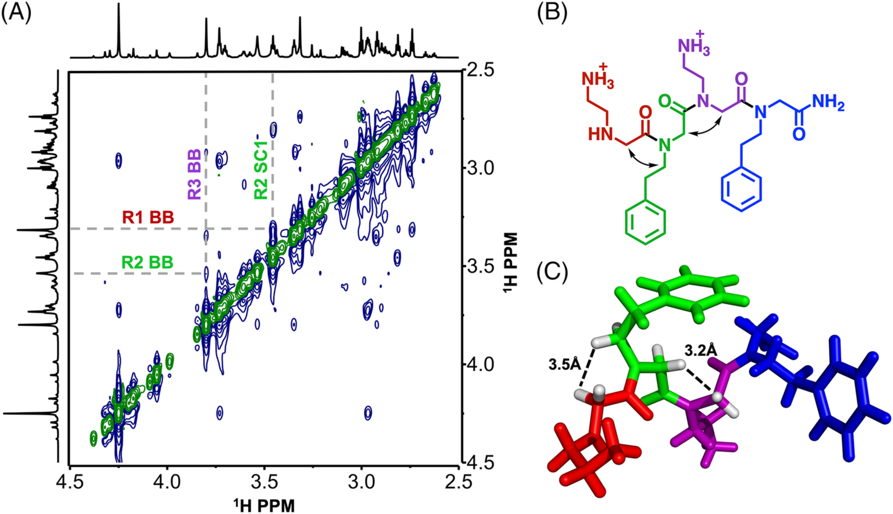

# peptoid_ESM
This repository compares Enhanced Sampling Methods for peptoid 19AE1-4-A in the Systematic and Extensible force field for Peptoids (STEPs).

### 19AE-1-4-A/
This folder contains the base GROMACS input set (topology, coordinates, index) for 19AE1-4-A from the [Peptoid Data Bank](https://databank.peptoids.org/), shared by all the sampling methods below. See `19AE-1-4-A/README.md` for details.
* [19AE1-4-A](https://databank.peptoids.org/peptoid/19AE1-4-A) - An Unconstrained Linear Tetramer in water.  Ref: [Roe et al. Biopolymers 2019](https://doi.org/10.1002/bip.23267)
* Solution: Water
* Water Model: TIP3P
* Force Field: [STEPs](https://pubs.acs.org/doi/10.1021/acs.jpcb.3c01424)
* Simulation Package: GROMACS
* Prepared by: Bradely & Marcel

### HREX/
Hamiltonian Replica Exchange: open/change the torsional potential and exchange replicas at constant temperature.
* Prepared by: Starwing & Vince 

### EE/
Expanded Ensemble: the torsional-bias (lambda) state is sampled as an extra degree of freedom within one continuous trajectory.
* Prepared by: Starwing & Vince

### REDs/

Replica Exchange with Dynamic Scaling.
* Prepared by: Steven

### Metadynamics/

Well-tempered (PBMetaD) metadynamics biasing the backbone omega dihedrals.
* Prepared by: Bradely & Marcel

### Plain_MD/

Unbiased MD, same system starting from 8 different cis/trans states.
* Prepared by: Starwing & Vince & Bradely

### Timescale analysis: autocorrelation & MSM

Every method computes two kinetics metrics for the ω-dihedral cis/trans
isomerization, at both the per-residue (2-state cis/trans) and global
(8-state backbone conformer) level. Full derivation/rules live in
[`Analysis/ANALYSIS_RULES.md`](Analysis/ANALYSIS_RULES.md) (extracted from
the manuscript); summary:

* **Autocorrelation timescale**: the binary cis(0)/trans(1) signal of each ω
  angle, restricted to the unbiased ensemble (λ=0 replica/state), has its
  normalized autocovariance g(τ) computed via `np.correlate`, then τ_c is
  read off as the truncated sum `Σ g(τ)` over the first `Nmax` lags. How the
  mean/spread of that number is reported is **not the same code path for
  every method** (confirmed from each `autocorrelation*.ipynb`):
  * **HREX / REDs**: g(τ) and τ_c are computed independently per replica
    walker (6 for HREX, 3 for REDs); the reported number is the arithmetic
    mean **and the variance** (`np.mean`, `np.var` - the notebooks literally
    annotate the plot "Var: ... ns²", not std) of τ_c across those replicas.
  * **EE / Plain MD**: trajectories are randomly split into groups (5 for
    EE, 3 for Plain MD); within a group, g(τ) is one pooled/length-weighted
    autocorrelation over that group's many short trajectories
    (`multi_autocorr`), not a simple per-trajectory average. Across groups,
    the g(τ) *curve* is reported as the elementwise arithmetic mean and
    **standard deviation** (`np.nanmean`/`np.nanstd`, NaN-safe since groups
    have different max trajectory lengths) - plotted as mean ± std bands.
    τ_c itself is currently reported as a single point estimate from the
    full pooled dataset, not averaged/varied across the random groups.
  * **Metadynamics**: uses the same per-replica g(τ)/truncated-sum method as
    HREX/REDs, but the committed `autocorr_from_extract.ipynb` only
    processes one walker/CV-variant's `timeomega.dat` file per run, by hand.
    There's no cross-walker mean ± std aggregation visible in that notebook,
    even though the manuscript's methodology (and `ANALYSIS_RULES.md`)
    describes "one block per walker" averaging over the 8 walkers - treat
    that aggregation step as intended but not (yet) present in committed
    code, not as confirmed.
* **Markov State Model (MSM)**: cis/trans (or 8-state) readings are combined
  with the method's thermodynamic/λ index into a joint transition matrix at
  each lag time τ, with a 0.25 pseudocount added to every element
  (`common/transition_matrix.py`, shared by HREX/REDs/EE/Plain MD and mirrored
  by Metadynamics' own notebook). The stationary population π is the
  eigenvalue-1 eigenvector; the implied timescale
  `t_2 = -τ / ln(μ_2)` comes from the second-largest eigenvalue. **π and
  t_2 are averaged differently, identically across all five methods**:
  * π (stationary population): plain arithmetic mean and standard deviation
    across partitions - `pi_means = np.mean(pi_all, axis=0)`,
    `pi_std = np.std(pi_all, axis=0)`.
  * t_2 (implied timescale): **geometric** mean and geometric std, i.e.
    computed in log-space then exponentiated -
    `t2_mean = exp(mean(log(t2)))`, `t2_std = exp(sqrt(var(log(t2))))`. This
    is not a documentation choice - it's hard-coded into the shared
    `process_trajectory()` helper (and Metadynamics' copy of it), so every
    method's reported implied-timescale error bar is a geometric, not
    arithmetic, spread.
  * What differs per method is only how the partitions feeding that
    mean/std are built (`cluster_size` in `get_transition_matrices`):
    HREX/REDs use `cluster_size=1` (each replica/walker is its own
    partition); EE uses `cluster_size=10` (the ~742 short trajectories are
    randomly shuffled into groups of 10); Plain MD uses `cluster_size=100`.
  * The lag time used for the *reported* stationary population is picked at
    the inflection point of t_2 vs. τ (Plain MD: 10 ns; HREX/EE/REDS: 2 ns;
    both META variants: 2.2 ns).

**Metadynamics (PBMetaD) MSM differs in how the partitions themselves are
built**, and in one respect actually diverges from the manuscript's stated
methodology - worth calling out precisely rather than smoothing over:
* Because it's one continuous, bias-evolving trajectory rather than several
  independent replicas/trajectories, `transition_matrix.ipynb` instead draws
  `n_bootstrap_samples` random, fixed-length (>=10,000-frame) segments, with
  random start positions, from that single trajectory
  (`get_bootstrap_transition_matrices`). The "bootstrapped" output file uses
  `n_bootstrap_samples=10`; the "no-bootstrap" (`_nobs`) file uses
  `n_bootstrap_samples=1` (a single-pass point estimate, still routed through
  the same bootstrap-shaped code, hence the naming). π/t_2 mean/std across
  those samples follow the same arithmetic-π / geometric-t_2 convention above.
* The manuscript (`ANALYSIS_RULES.md` §3.2) states PBMetaD should have **no**
  MSM/lag-time curve fit at all - instead a bias-reweighted (`exp(beta *
  pb.bias)`), late-block flat reference population ± SEM. As committed,
  `transition_matrix.ipynb` does not apply any `pb.bias` reweighting to the
  transition counts (no `pb.bias`/`reweight`/`logsumexp` in that notebook) -
  it builds the transition matrix/eigenvector directly off the raw (biased)
  cis/trans trajectory, and its output is what `Analysis/` later plots as
  `stationary_distributions.pkl` for META. Treat the bias-reweighted flat
  reference described in the manuscript as the intended final methodology,
  and this notebook's un-reweighted bootstrap MSM as the current, possibly
  provisional, implementation - this is one of the "open/unresolved" items
  already flagged in `Analysis/ANALYSIS_RULES.md` §5.
* Several PBMetaD collective-variable (CV) variants were run (ω-only, ω+φ,
  ω+φ+ψ, ω+φ+ψ+χ, each with single- and 8-walker versions); only the
  ω-only (META-OMG8REP) and ω+φ+ψ+χ (META-OPPC8REP) 8-walker variants are
  part of the main cross-method comparison - see
  [`Metadynamics/analysis/README.md`](Metadynamics/analysis/README.md) for
  the full variant naming/pipeline and which variants are SI-only.

See each method's own `analysis/README.md` (`EE/analysis/README.md`,
`HREX/analysis/README.md`, `REDs/analysis/README.md`,
`Plain_MD/analysis/README.md`, `Metadynamics/analysis/README.md`) for the
notebook-level workflow behind these numbers, and `Analysis/README.md` for
how the per-method outputs are aggregated into cross-method comparison
figures.

### Analysis/

Cross-method comparison: aggregates the per-method outputs from `EE/`, `HREX/`, `REDs/`, `Metadynamics/`, and `Plain_MD/` into combined convergence, population, and autocorrelation figures/tables across all five sampling methods. See `Analysis/README.md`. Before generating any new graph or analysis, read `Analysis/ANALYSIS_RULES.md` (the manuscript's methodology/results logic, extracted as a rule set) and `Analysis/PLOTTING_STYLE.md` (visual style guide).

### figs/

Schematic/explainer figures (method diagrams, animations) used in documentation and the manuscript - not simulation-derived output. See `figs/README.md`.

### manuscript/

Manuscript draft comparing the enhanced-sampling methods (currently a placeholder).